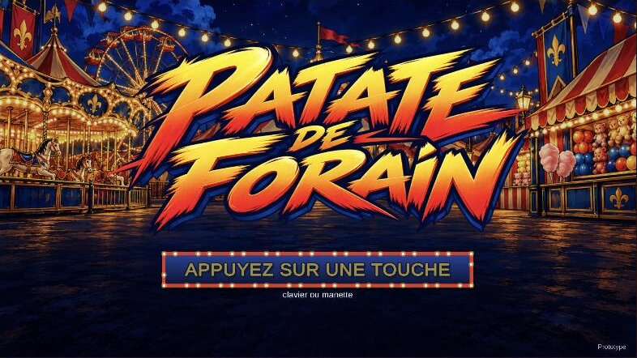
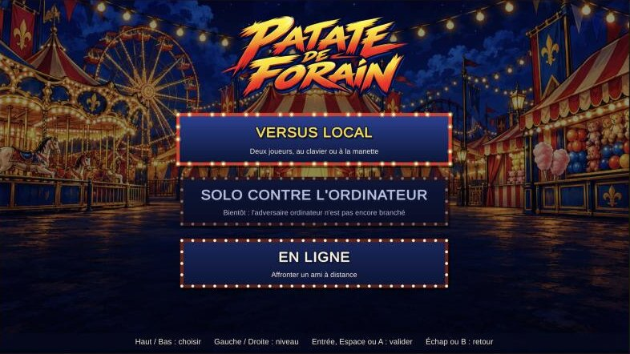
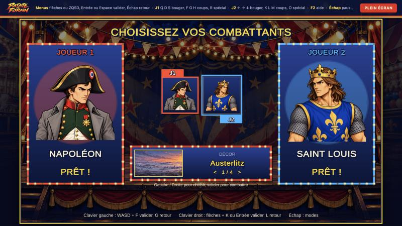
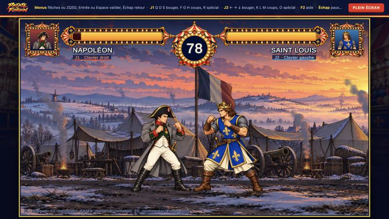
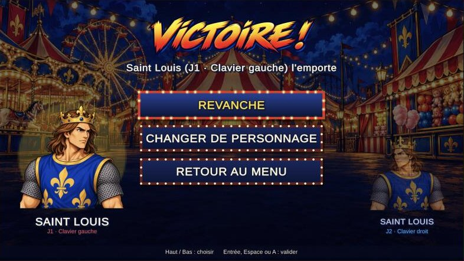
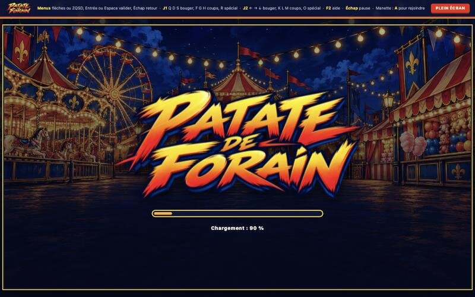
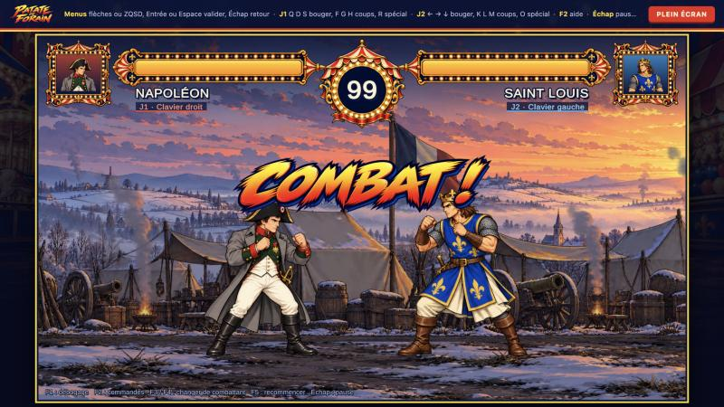
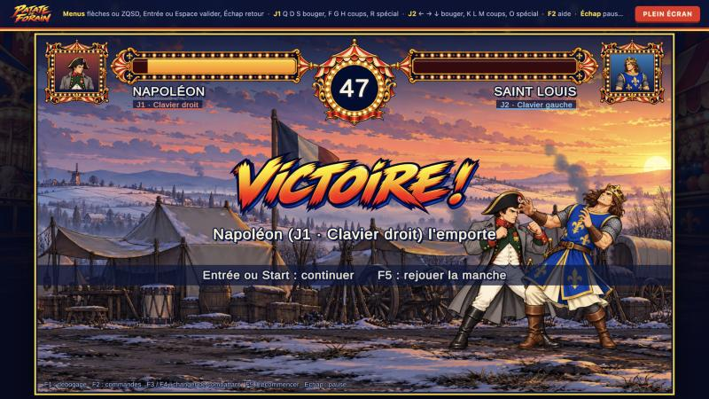

# Patate de Forain

Jeu de combat 2D aux sensations arcade, avec nos propres personnages et notre direction artistique. Construit avec Unity, sur le modèle d'Action Legends.

**État : prototype jouable.** Écran titre, choix du mode, sélection des personnages, combat et résultat, à deux joueurs sur un clavier (Saint Louis pour l'instant). Voir [l'état du prototype](docs/etat-du-prototype.md) pour le détail de ce qui fonctionne, de ce qui a été vérifié et de ce qui manque.

## Lancer le jeu

1. Unity **6000.4.7f1**. Dans Unity Hub : *Add project from disk* → choisir le dossier **`game/`**.
   Ne pas ouvrir la racine du dépôt : sur macOS, `assets/` (les sources de l'équipe artistique) et `Assets/` désignent le même dossier, et Unity y écrirait ses fichiers.
2. Ouvrir la scène `Assets/Scenes/Combat.unity`.
3. **Play**. La fenêtre Game doit avoir le focus clavier ; le jeu se met en pause quand elle le perd.

Le jeu s'ouvre sur l'écran titre. Parcours : titre → mode (Versus local, Solo contre l'ordinateur, En ligne) → sélection des personnages → combat → résultat (revanche, changer de personnage, retour au menu). Voir [L'interface](#linterface).

## Version navigateur (WebGL)

Le module *WebGL Build Support* de Unity 6000.4.7f1 doit être installé (Unity Hub › Installs › Add modules).

- **Dans l'éditeur** : *File › Build Profiles* › **Web** › *Switch Platform*, puis menu *Patate de Forain › Construire la version navigateur*.
- **En ligne de commande**, sans ouvrir l'éditeur sur ce projet (Unity lancé en mode batch), depuis `game/` :

```bash
unity build --target WebGL --execute-method Patate.EditorTools.WebBuilder.Build .
```

La version est écrite dans `game/WebBuild/` (ignoré par git ; la variable `PATATE_WEB_DIR` change ce dossier). Fichiers compressés en Gzip avec décompression de repli et sans threads : n'importe quel hébergeur statique convient, GitHub Pages compris (`.nojekyll` et `build-info.json` sont ajoutés). Pour l'essayer en local, depuis la racine du dépôt :

```bash
python3 -m http.server 8765 --directory game/WebBuild
```

puis ouvrir <http://localhost:8765> et **cliquer dans le jeu** pour lui donner le clavier. Ouvrir `index.html` directement depuis le disque ne fonctionne pas.

Poids téléchargé : environ **19 Mo** (code 7,6 Mo, données 10,5 Mo : atlas de Saint Louis et de Napoléon, décor de la fête foraine, images de l'interface).

La page vient du gabarit `game/Assets/WebGLTemplates/PatateDeForain/` (choisi par `WebBuilder`) : le logo et une barre de progression pendant le chargement, puis le jeu en 16:9 ajusté à la taille de la fenêtre, un bouton plein écran et le rappel des commandes. L'écran « Made with Unity » est désactivé.

## Commandes

Les touches sont des **positions physiques** (Input System). Les noms ci-dessous sont ceux d'un clavier **AZERTY** ; l'aide en jeu (**F2**) affiche les noms de votre disposition réelle.

| Action | Joueur 1 | Joueur 2 |
|---|---|---|
| Avancer / reculer | **Q** / **D** | **←** / **→** |
| Bas (pour le quart de cercle) | **S** | **↓** |
| Garder | tenir la direction opposée à l'adversaire | idem |
| Poing | **F** | **K** ou pavé **1** |
| Pied rapide | **G** | **L** ou pavé **2** |
| Pied puissant | **H** | **M** ou pavé **3** |
| Spécial (Poing de Saint Louis) | **R**, ou bas, bas-avant, avant + poing | **O** ou pavé **0**, ou ↓ ↘ → + poing |

| Touche | Effet |
|---|---|
| **F1** | Débogage : boîtes de collision, états, entrées, empreinte de l'état (mémorisé) |
| **F2** | Aide des commandes |
| **F3** / **F4** | Combattant suivant pour J1 / J2 (relance la manche) |
| **F5** | Recommencer la manche |
| **Entrée** (ou **Start** à la manette) en fin de manche | Écran de résultat |
| **Échap** | Pause |

### Manette

Manettes Xbox, PlayStation ou toute manette reconnue comme manette standard, y compris dans le navigateur. **En WebGL, appuyer d'abord sur un bouton de la manette** : le navigateur ne la signale au jeu qu'à ce moment. Disposition arcade, rangée du haut pour le poing et le spécial, rangée du bas pour les pieds :

| Action | Bouton (Xbox / PlayStation) |
|---|---|
| Déplacements, bas | stick gauche ou croix |
| Garder | tenir la direction opposée à l'adversaire |
| Poing | **X** / **Carré** |
| Pied rapide | **A** / **Croix** |
| Pied puissant | **B** / **Rond** |
| Spécial | **Y** / **Triangle**, ou bas, bas-avant, avant + poing |

Les touches de service (F1 à F5, Échap, Entrée) restent au clavier. Une manette débranchée en plein combat ne commande plus rien ; rebranchée, elle reprend.

### Contre l'ordinateur

En mode solo, l'adversaire est joué par l'ordinateur, en trois niveaux (facile, normal, difficile) qui changent son temps de réaction, sa garde et son agressivité. Le choix se fera dans l'écran de sélection (en cours) ; d'ici là, voir `MatchSetup.Players` (`PlayerSource.Cpu(0 | 1 | 2)`).

À deux sur un même clavier, certaines combinaisons de nombreuses touches simultanées peuvent ne pas être détectées (limite matérielle du clavier). Le pavé numérique du joueur 2 aide à l'éviter quand il existe.

## L'interface

Dessinée en IMGUI, comme le reste de l'affichage et comme Action Legends : rien à régler dans la scène, compatible WebGL, et la navigation clavier et manette passe par une seule couche (`MenuInput`). Le style reprend le logo et la fête foraine : fond peint du champ de foire, enseignes à ampoules, textes détourés de bleu marine, annonces de manche peintes dans le lettrage du logo.



| Écran | Commandes |
|---|---|
| **Titre** | n'importe quelle touche, un clic ou un bouton de manette |
| **Mode** | haut / bas pour choisir, gauche / droite pour le niveau de l'ordinateur, **Entrée**, **Espace** ou **A** pour valider, **Échap** ou **B** pour revenir |
| **Sélection** | chaque joueur **rejoint** en appuyant sur la validation de son appareil : moitié gauche du clavier **F** ou **Espace**, moitié droite **K** ou **Entrée**, manette **A**. Il déplace ensuite son curseur avec ses propres directions (**ZQSD**, flèches, croix ou stick), valide, et revient en arrière avec **G**, **L** ou **B** (déverrouiller, puis quitter la place). **Échap** revient aux modes. Le décor se choisit après les combattants s'il y en a plusieurs |
| **Résultat** | revanche (mêmes réglages), changer de personnage (mêmes joueurs), retour au menu |

- **Solo** : le joueur choisit son combattant puis celui de l'ordinateur ; niveaux facile, normal, difficile (`PlayerSource.Cpu(0)` à `Cpu(2)`). Tant que l'adversaire ordinateur n'est pas branché dans `InputSources`, le mode est affiché « Bientôt » et ne se valide pas.
- **Manettes** : elles pilotent déjà tous les menus. Pour rejoindre un combat, il faut que `InputSources` sache les créer ; d'ici là, l'écran de sélection l'indique quand une manette essaie de rejoindre.
- **En ligne** ouvre le salon : choisir son combattant, créer un salon ou taper le code d'un salon existant, puis se déclarer prêt. Clavier, manette ou souris.
- **HUD** : portraits, jauges de vie avec traînée des dégâts récents (clignotantes sous 25 %), médaillon du chronomètre (rouge sous 10 secondes), noms et appareil de chaque joueur, annonces « Manche 1 », « Prêts ? », « Combat ! », « K.O. ! », « Temps écoulé ! », « Victoire ! », « Égalité », pause et aide (**F2**).

| Mode | Sélection | Combat | Résultat |
|---|---|---|---|
|  |  |  |  |

| Chargement dans le navigateur | Annonce de manche | K.O. |
|---|---|---|
|  |  |  |

Captures prises dans la version WebGL, pilotée au clavier.

Code : `Ui.cs` (palette et éléments graphiques), `MenuInput.cs` (commandes des menus, appareils, `InputSupport`), `TitleScreen`, `ModeSelectScreen`, `CharacterSelectScreen` (règles testées dans `CharacterSelection`), `ResultScreen`, `Hud`. Images : `game/Assets/Resources/UI/` (fond, logo, mots d'annonce dans `words/`), générées avec Codex CLI à partir du logo et du portrait de Saint Louis ; une image absente est remplacée par un texte.

## Vérifier

- **Tests (115)** : dans Unity, *Window › General › Test Runner › EditMode › Run All*. Ou en ligne de commande, éditeur ouvert, depuis `game/` : `unity command test run --mode editor`.
- **Paquets de combattants** : menu *Patate de Forain › Valider les combattants*.
- **Scénario en jeu scripté** : `AgentScripts/VerifyMatch.cs` (mode d'emploi en tête de fichier).

## Jouer en ligne

Deux joueurs, chacun sur sa machine (navigateur ou PC), dans un salon désigné par un code. Le relais est déployé sur Cloudflare (`wss://patate-relais.eth3rnit3.workers.dev`) : c'est celui du jeu publié. L'éditeur et une page servie depuis `localhost` utilisent le relais local (`cd server/relay && npm install && npm start`), sauf avec `?relais=wss://…`. L'un crée le salon, l'autre entre son code. On y accède par le menu (**En ligne**), ou directement par un lien `?salon=CODE` (`-salon CODE` sur PC). Lancement, paramètres, essais et déploiement sur Cloudflare : [server/relay/README.md](server/relay/README.md).

## Intégrer des visuels

Depuis la racine du dépôt (Node 22) :

```bash
npm install
npm run assets:export -- tools/export-character/configs/saint-louis.json
```

L'outil lit les planches sources sans les modifier. Il produit des images individuelles et des aperçus de contrôle dans `assets/characters/<personnage>/export/`, puis l'atlas du jeu dans `game/Assets/Resources/Fighters/<personnage>/`. Le rapport `export-report.md` décrit chaque traitement.

## Documentation

- [Architecture](docs/architecture.md) : les couches, la simulation, les points d'extension et le jeu en ligne.
- [Relais en ligne](server/relay/README.md) : lancer le relais, essayer à deux, le déployer.
- [Ajouter un combattant](docs/ajouter-un-combattant.md) : guide complet, avec l'exemple de Napoléon.
- [État du prototype](docs/etat-du-prototype.md) : ce qui marche, ce qui est vérifié, les limites et les besoins artistiques.
- [Standard personnage](docs/character-standard-v01.md) : direction artistique et format des exports.
