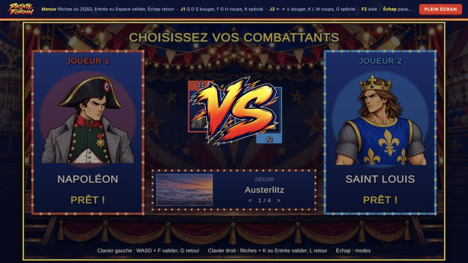
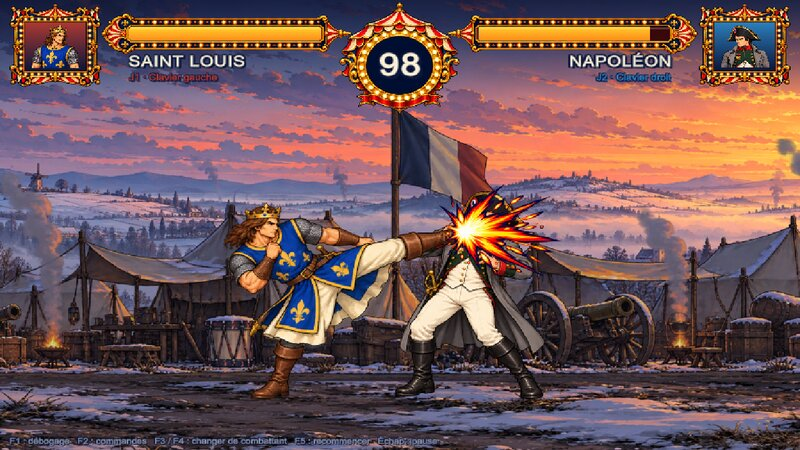

# Patate de Forain

Jeu de combat 2D aux sensations arcade, avec nos propres personnages et notre direction artistique. Construit avec Unity, sur le modèle d'Action Legends.

**Jouer dans le navigateur : <https://eth3rnit3.github.io/patate-de-forain/>** (publié automatiquement depuis `main`, voir [Intégration continue](#intégration-continue-et-github-pages)).

**État : prototype jouable.** Saint Louis, Napoléon et De Gaulle, quatre décors, versus local au clavier ou à la manette, solo contre l'ordinateur et combat en ligne. Voir [l'état du prototype](docs/etat-du-prototype.md) pour le détail de ce qui fonctionne, de ce qui a été vérifié et de ce qui manque.

## Lancer le jeu

1. Unity **6000.4.7f1**. Dans Unity Hub : *Add project from disk* → choisir le dossier **`game/`**.
   Ne pas ouvrir la racine du dépôt : sur macOS, `assets/` (les sources de l'équipe artistique) et `Assets/` désignent le même dossier, et Unity y écrirait ses fichiers.
2. Ouvrir la scène `Assets/Scenes/Combat.unity`.
3. **Play**. La fenêtre Game doit avoir le focus clavier ; le jeu se met en pause quand elle le perd.

Le jeu s'ouvre sur l'écran titre. Parcours : titre → mode (Versus local, Solo contre l'ordinateur, En ligne) → sélection des personnages → combat → résultat (revanche, changer de personnage, retour au menu). Voir [L'interface](#linterface).

## Version navigateur (WebGL)

Le module *WebGL Build Support* de Unity 6000.4.7f1 doit être installé (Unity Hub › Installs › Add modules).

- **Dans l'éditeur** : *File › Build Profiles* › **Web** › *Switch Platform*, puis menu *Patate de Forain › Construire la version navigateur*.
- **En ligne de commande**, sans ouvrir l'éditeur sur ce projet (Unity lancé en mode batch), depuis `game/` :

```bash
unity build --target WebGL --execute-method Patate.EditorTools.WebBuilder.Build .
```

La version est écrite dans `game/WebBuild/` (ignoré par git ; la variable `PATATE_WEB_DIR` change ce dossier). Fichiers compressés en Gzip avec décompression de repli et sans threads : n'importe quel hébergeur statique convient, GitHub Pages compris (`.nojekyll` et `build-info.json` sont ajoutés). Pour l'essayer en local, depuis la racine du dépôt :

```bash
python3 -m http.server 8765 --directory game/WebBuild
```

puis ouvrir <http://localhost:8765> et **cliquer dans le jeu** pour lui donner le clavier. Ouvrir `index.html` directement depuis le disque ne fonctionne pas.

Poids téléchargé : environ **27,5 Mo** (code 7,9 Mo, données 19,4 Mo : atlas de Saint Louis et de Napoléon avec les postures et le KO, trois décors, images de l'interface et des étincelles). Mesuré avant l'arrivée de De Gaulle, dont l'atlas n'a pas encore été pesé dans une version navigateur.

### Intégration continue et GitHub Pages

Le workflow `.github/workflows/web.yml` reprend celui d'Action Legends :

1. **Outils et relais**, à chaque push et pull request, sans secret : types de l'outil d'export (`npm run typecheck`) et tests du relais en ligne (`npm test --prefix server/relay`).
2. **Tests EditMode**, puis **Version navigateur** : GameCI (`game-ci/unity-test-runner`, `game-ci/unity-builder`) sur `main` seulement, quand la variable `UNITY_CI_ENABLED` vaut `true`. La compilation appelle `Patate.EditorTools.WebBuilder.Build` ; l'export est aussi gardé 14 jours dans les artifacts (`patate-de-forain-web`).
3. **Publication GitHub Pages** : après une compilation réussie, quand `PUBLISH_PAGES` vaut `true`. Le dépôt est public ; Pages a GitHub Actions comme source.

GameCI a besoin d'une activation Unity : secrets `UNITY_LICENSE` (contenu du fichier `.ulf`), `UNITY_EMAIL` et `UNITY_PASSWORD`, à ajouter dans les paramètres GitHub Actions du dépôt, jamais dans le code. Passer `UNITY_CI_ENABLED` à `false` suspend la compilation (par exemple le temps de renouveler la licence) sans bloquer les vérifications. Références : [activation GameCI](https://game.ci/docs/github/activation/), [Unity Builder](https://github.com/game-ci/unity-builder).

La page vient du gabarit `game/Assets/WebGLTemplates/PatateDeForain/` (choisi par `WebBuilder`) : le logo et une barre de progression pendant le chargement, puis le jeu en 16:9 ajusté à la taille de la fenêtre, un bouton plein écran et le rappel des commandes. L'écran « Made with Unity » est désactivé.

## Commandes

Les touches sont des **positions physiques** (Input System). Les noms ci-dessous sont ceux d'un clavier **AZERTY** ; l'aide en jeu (**F2**) affiche les noms de votre disposition réelle.

| Action | Joueur 1 | Joueur 2 |
|---|---|---|
| Avancer / reculer | **Q** / **D** | **←** / **→** |
| Sauter (haut-avant, haut-arrière : saut en avant, en arrière) | **Z** | **↑** |
| S'accroupir (et bas du quart de cercle) | **S** | **↓** |
| Garder | tenir la direction opposée à l'adversaire ; bas-arrière contre les coups bas | idem |
| Coups accroupis / sautés | poing ou pied en tenant bas / pendant un saut (un coup par saut) | idem |
| Poing | **F** | **K** ou pavé **1** |
| Pied rapide | **G** | **L** ou pavé **2** |
| Pied puissant | **H** | **M** ou pavé **3** |
| Spécial (Poing de Saint Louis) | **R**, ou bas, bas-avant, avant + poing | **O** ou pavé **0**, ou ↓ ↘ → + poing |

| Touche | Effet |
|---|---|
| **F1** | Débogage : boîtes de collision, états, entrées, empreinte de l'état (mémorisé) |
| **F2** | Aide des commandes |
| **F3** / **F4** | Combattant suivant pour J1 / J2 (relance la manche) |
| **F5** | Recommencer la manche |
| **Entrée** (ou **Start** à la manette) en fin de manche | Écran de résultat |
| **Échap** | Pause |

### Manette

Manettes Xbox, PlayStation ou toute manette reconnue comme manette standard, y compris dans le navigateur. **En WebGL, appuyer d'abord sur un bouton de la manette** : le navigateur ne la signale au jeu qu'à ce moment. Disposition arcade, rangée du haut pour le poing et le spécial, rangée du bas pour les pieds :

| Action | Bouton (Xbox / PlayStation) |
|---|---|
| Déplacements, bas | stick gauche ou croix |
| Sauter, s'accroupir | haut, bas (stick gauche ou croix) |
| Garder | tenir la direction opposée à l'adversaire ; bas-arrière contre les coups bas |
| Poing | **X** / **Carré** |
| Pied rapide | **A** / **Croix** |
| Pied puissant | **B** / **Rond** |
| Spécial | **Y** / **Triangle**, ou bas, bas-avant, avant + poing |

Les touches de service (F1 à F5, Échap, Entrée) restent au clavier. Une manette débranchée en plein combat ne commande plus rien ; rebranchée, elle reprend.

### Contre l'ordinateur

En mode solo, l'adversaire est joué par l'ordinateur, en trois niveaux (facile, normal, difficile) qui changent son temps de réaction, sa garde et son agressivité. Le choix se fera dans l'écran de sélection (en cours) ; d'ici là, voir `MatchSetup.Players` (`PlayerSource.Cpu(0 | 1 | 2)`).

À deux sur un même clavier, certaines combinaisons de nombreuses touches simultanées peuvent ne pas être détectées (limite matérielle du clavier). Le pavé numérique du joueur 2 aide à l'éviter quand il existe.

## L'interface

Dessinée en IMGUI, comme le reste de l'affichage et comme Action Legends : rien à régler dans la scène, compatible WebGL, et la navigation clavier et manette passe par une seule couche (`MenuInput`). Le style reprend le logo et la fête foraine : fonds peints (champ de foire pour les menus, baraque de lutteurs pour la sélection, podium pour le résultat), enseignes à ampoules, textes détourés de bleu marine, annonces de manche et emblème « VS » peints dans le lettrage du logo, cadres dorés du HUD. Les titres, noms, boutons et le chronomètre sont en **Bangers** (police d'affichage penchée, licence OFL, `game/Assets/Resources/UI/fonts/` avec sa licence) ; les textes d'aide gardent la police par défaut, plus lisible en petit.


| Écran | Commandes |
|---|---|
| **Titre** | n'importe quelle touche, un clic ou un bouton de manette |
| **Mode** | haut / bas pour choisir, gauche / droite pour le niveau de l'ordinateur, **Entrée**, **Espace** ou **A** pour valider, **Échap** ou **B** pour revenir |
| **Qui joue ?** | chaque joueur choisit son appareil : **Clavier gauche**, **Clavier droit**, **Manette 1**, **Manette 2**… (haut / bas : joueur, gauche / droite : appareil). Prendre l'appareil de l'autre joueur les échange. En Solo et en ligne, un seul joueur choisit. Un appui sur un appareil allume son nom, pour le reconnaître. **Entrée**, **Espace** ou **A** pour continuer, **Échap** ou **B** pour revenir |
| **Sélection** | les joueurs arrivent placés avec l'appareil choisi ; un appareil libre peut encore **rejoindre** une place vide en appuyant sur la validation de son appareil : moitié gauche du clavier **F** ou **Espace**, moitié droite **K** ou **Entrée**, manette **A**. Il déplace ensuite son curseur avec ses propres directions (**ZQSD**, flèches, croix ou stick), valide, et revient en arrière avec **G**, **L** ou **B** (déverrouiller, puis quitter la place). **Échap**, ou quitter sa place, revient au choix des appareils. Le décor se choisit ensuite, avec sa vignette (gauche / droite) |
| **Résultat** | revanche (mêmes réglages), changer de personnage (mêmes joueurs), retour au menu |

- **Solo** : le joueur choisit son combattant puis celui de l'ordinateur ; niveaux facile, normal, difficile (`PlayerSource.Cpu(0)` à `Cpu(2)`).
- **Manettes** : elles pilotent tous les menus et jouent en combat. Dans le navigateur, une manette n'apparaît qu'après un premier appui sur l'un de ses boutons ; l'écran « Qui joue ? » suit les branchements en direct.
- **En ligne** ouvre le salon : choisir son combattant, créer un salon ou taper le code d'un salon existant, puis se déclarer prêt. Clavier, manette ou souris.
- **Décors** : la fête foraine, la Sainte-Chapelle (Saint Louis) et Austerlitz (Napoléon), chacun en trois calques peints avec parallaxe, plus l'arène d'entraînement.
- **HUD** : portraits et jauges de vie dans des cadres dorés peints, traînée des dégâts récents (clignotante sous 25 %), médaillon du chronomètre (rouge sous 10 secondes), étincelles peintes sur les coups au corps qui touchent ou sont gardés, noms et appareil de chaque joueur, annonces « Manche 1 », « Prêts ? », « Combat ! », « K.O. ! », « Temps écoulé ! », « Victoire ! », « Égalité », pause et aide (**F2**).

| Mode | Sélection | Face-à-face | Résultat |
|---|---|---|---|
|  |  |  |  |

| Annonce de manche | Combat | Étincelle de coup | K.O. |
|---|---|---|---|
|  |  |  |  |


Captures prises dans la version WebGL, pilotée au clavier, sauf l'étincelle (éditeur, combat scripté par `AgentScripts/VerifyEffects.cs`). L'étincelle, le K.O. et le chargement datent d'avant la police Bangers.

Code : `Ui.cs` (palette et éléments graphiques), `MenuInput.cs` (commandes des menus, appareils, `InputSupport`), `TitleScreen`, `ModeSelectScreen`, `CharacterSelectScreen` (règles testées dans `CharacterSelection`), `ResultScreen`, `Hud`, `SharedEffects` (étincelles). Images : `game/Assets/Resources/UI/` (fonds, logo, « VS », mots d'annonce dans `words/`, cadres du HUD dans `hud/`) et `game/Assets/Resources/Effects/`, générées avec Codex CLI à partir du logo et du portrait de Saint Louis ; une image absente est remplacée par le dessin d'origine ou un texte. Sources, prompts et commandes d'export : [assets/ui/README.md](assets/ui/README.md).

**Générer une image avec Codex CLI** : chaque dossier d'assets a un `prompts-v01.json` ; `python3 tools/codex-image/generate.py <dossier> prompts-v01.json <n>` relance l'entrée n avec ses images de référence (modèle `gpt-5.6-sol` par défaut, `CODEX_MODEL` pour en changer).

## Vérifier

- **Tests (124)** : dans Unity, *Window › General › Test Runner › EditMode › Run All*. Ou en ligne de commande, éditeur ouvert, depuis `game/` : `unity command test run --mode editor`.
- **Paquets de combattants** : menu *Patate de Forain › Valider les combattants*.
- **Scénario en jeu scripté** : `AgentScripts/VerifyMatch.cs` (mode d'emploi en tête de fichier).

## Jouer en ligne

Deux joueurs, chacun sur sa machine (navigateur ou PC), dans un salon désigné par un code. Le relais est déployé sur Cloudflare (`wss://patate-relais.eth3rnit3.workers.dev`) : c'est celui du jeu publié. L'éditeur et une page servie depuis `localhost` utilisent le relais local (`cd server/relay && npm install && npm start`), sauf avec `?relais=wss://…`. L'un crée le salon, l'autre entre son code. On y accède par le menu (**En ligne**), ou directement par un lien `?salon=CODE` (`-salon CODE` sur PC). Lancement, paramètres, essais et déploiement sur Cloudflare : [server/relay/README.md](server/relay/README.md).

## Intégrer des visuels

Depuis la racine du dépôt (Node 22) :

```bash
npm install
npm run assets:export -- tools/export-character/configs/saint-louis.json
```

L'outil lit les planches sources sans les modifier. Il produit des images individuelles et des aperçus de contrôle dans `assets/characters/<personnage>/export/`, puis l'atlas du jeu dans `game/Assets/Resources/Fighters/<personnage>/`. Le rapport `export-report.md` décrit chaque traitement.

## Documentation

- [Architecture](docs/architecture.md) : les couches, la simulation, les points d'extension et le jeu en ligne.
- [Relais en ligne](server/relay/README.md) : lancer le relais, essayer à deux, le déployer.
- [Ajouter un combattant](docs/ajouter-un-combattant.md) : guide complet, avec l'exemple de Napoléon.
- [État du prototype](docs/etat-du-prototype.md) : ce qui marche, ce qui est vérifié, les limites et les besoins artistiques.
- [Standard personnage](docs/character-standard-v01.md) : direction artistique et format des exports.
